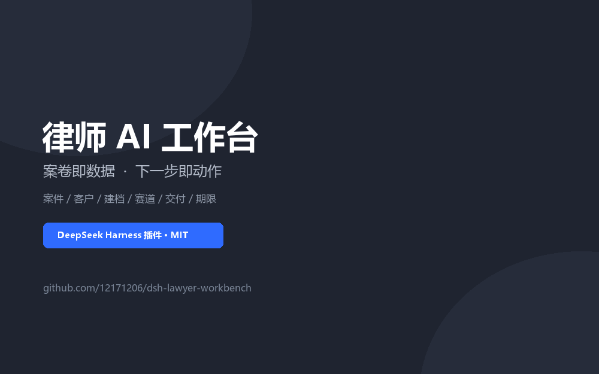
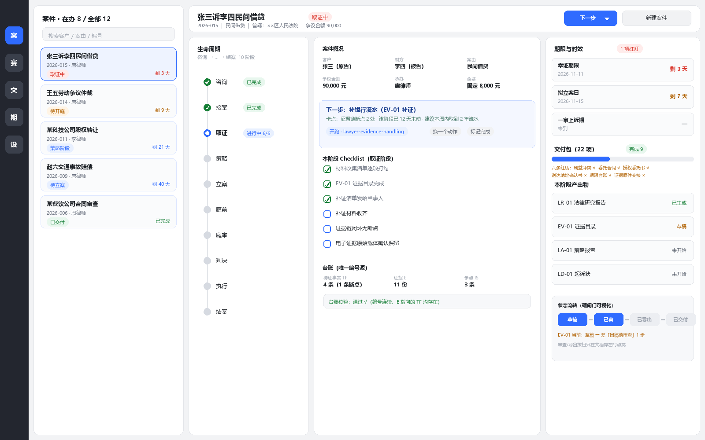
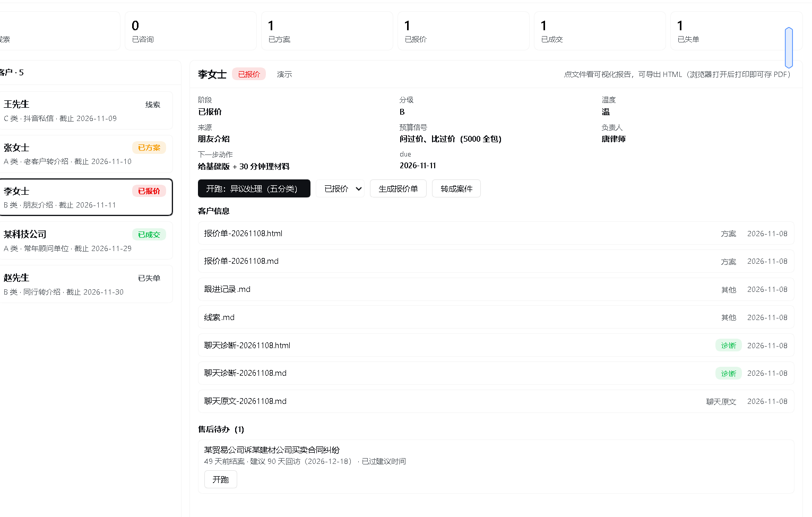
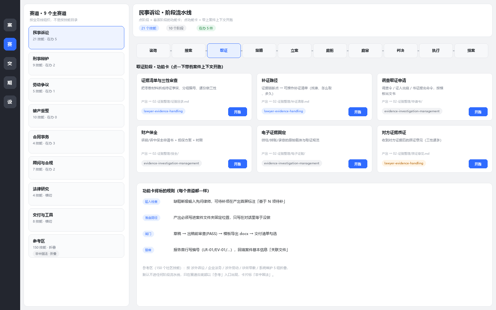
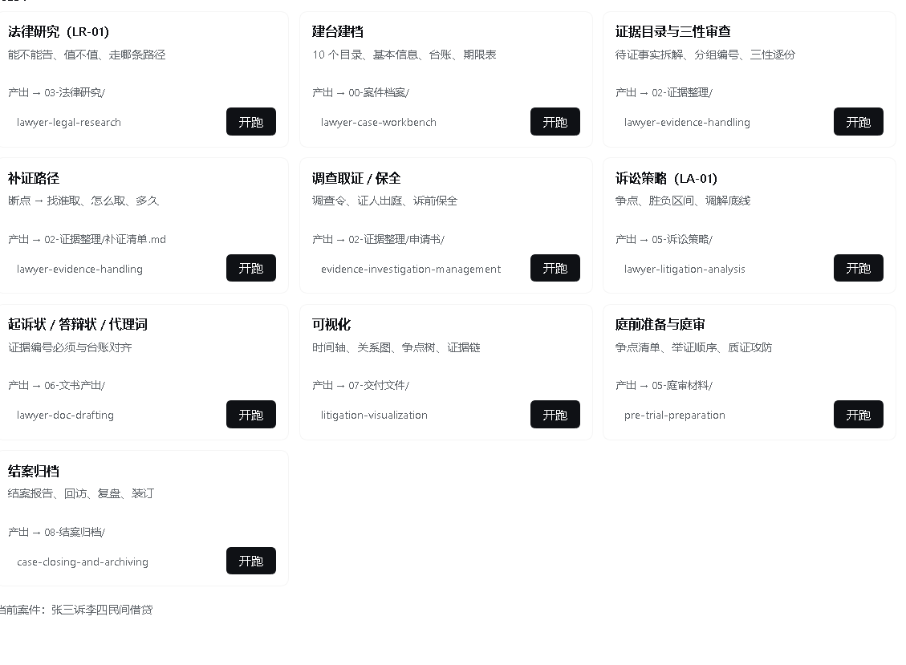

# 律师 AI 工作台（DeepSeek Harness 插件）

把法律 AI 从"聊天框"变成**律师每天打开的办案台**：一个案子一个文件夹，打开就知道卡在哪、下一步做什么，一键把活派给对应技能，产出自动落盘、期限不丢。

> 本仓库是 **DSH（DeepSeek Harness）Web 端插件 + 一个配套技能 + 方法与话术文档**。
> 不含任何第三方技能包原始文件（详见 `NOTICE.md`）。



> 20 秒真实操作录屏：案件台 → 客户台/邀约铺垫 → 赛道台/立案 → 期限台 → 建档向导 → 回到案件台。MP4 版：[demo.mp4](docs/assets/demo.mp4)

---

## 它解决什么问题

| 没有它 | 有它 |
|---|---|
| 217 个技能记不住名字，不知道点哪个 | 只显示「案子 + 阶段 + 下一步」 |
| 每个新会话都要重新讲一遍案情 | 开跑自动带案件路径、阶段、台账、目标产物 |
| 产出散落在聊天里，找不回来 | 强制落盘到案件目录，自动出现在产出物列表 |
| 期限靠脑子记 | 期限台账 + 红黄灯 + `.ics` 日历导出 |
| 客户聊完就凉 | 客户台：诊断 → 三档方案 → 报价 → 邀约铺垫卡 |
| 材料手动改名归档 | 建档向导：按槽位传、zip 自动解压归类、每行可改目标文件夹 |

## 截图

| 案件台（三栏） | 客户台（转化漏斗 + 邀约铺垫） |
|---|---|
|  |  |

| 赛道台（按阶段过滤） | 功能卡（点开跑） |
|---|---|
|  |  |

---

## 功能

### 六个页签

| 页签 | 内容 |
|---|---|
| **案件** | 案件列表 + 详情三栏：生命周期 / 下一步 + Checklist / 期限 + 交付 + 产出；批量导出 Word |
| **客户** | 转化漏斗（线索→已咨询→已方案→已报价→已成交→已失单）、客户档案、邀约铺垫卡、报价表单、售后待办 |
| **建档** | 三步向导：选类型（客户/案件/补到已有）→ 按槽位上传（聊天记录/证据/法院文书/文书草稿/类案/zip）→ 预览归档位置（每行可改）→ 确认 |
| **赛道** | 9 条业务线 × 阶段 × 功能卡，点开跑即执行；参考区折叠海外技能 |
| **交付** | 草稿 / 已审 / 已导出 / 已交付 四列，导出未审标红 |
| **期限** | 今日/本周/30 天跨案件聚合，一键导出 `.ics` |

### 关键能力

- **清单驱动**：8 份案件档案（基本信息、台账、期限台账、交付包、Checklist、时间线…）决定界面
- **开跑带上下文**：提示词含案件路径、阶段、技能 `SKILL.md` 绝对路径、落盘位置
- **报告渲染 + 导出**：md → 排版文档 → HTML / Word（A4 公文版式：仿宋三号、28 磅行距、页码、可选红头）
- **截图 OCR**：Windows 自带中文 OCR，离线识别微信截图 → `聊天原文-OCR-日期.md`
- **安全**：每日自动备份（保留 7 天）、操作日志、脱敏副本、演示数据隔离

## 目录

```
plugin/                 DSH 插件（Host index.js + Client client.js + ocr.ps1 + md_to_docx.py）
skill/lawyer-chat-diagnose/   聊天记录诊断技能（9 段输出：阶段/顾虑/决策链/该不该约/今天发哪条）
docs/                  使用说明、设计方案、销售与邀约话术、技能包盘点
examples/xiaolu-case/  完整样例（真实类案判决 + 虚构咨询 + 诊断/方案/报价/LR 报告）
tools/build_catalog.py 把技能包扫描成 catalog.json
```

## 安装（DSH）

### 1. 插件

```bash
# 把 plugin/ 拷到任意目录，例如 C:\work\dsh-lawyer-workbench
# 编辑 plugin/cordis.patch.yml 里的路径
```

```yaml
- insert:
    - id: lawyer-workbench
      name: '@local/dsh-lawyer-workbench'
      config:
        caseRoot: 'C:\Users\you\Documents\律师工作目录'      # 案卷根目录
        catalogPath: 'C:\path\to\catalog.json'               # 技能目录（可选）
        sessionWorkspace: 'C:\Users\you\Documents\律师工作目录'
        python: 'C:\path\to\python.exe'                      # 导出 Word 用
        firmName: '某某律师事务所'                            # 红头，留空则无
```

然后让 DSH 安装这个本地 bundle（`plugin_manager install_bundle` 指向该绝对路径）。
改 `index.js` 后需重新加载插件；只改 `client.js` 刷新页面即可。

### 2. 技能（可选但推荐）

把 `skill/lawyer-chat-diagnose/` 拷到 `%USERPROFILE%\.dsh\skills\`，热加载生效。

### 3. 技能包（不在本仓库）

`catalogPath` 指向你自有的律师技能包扫描结果（用 `tools/build_catalog.py` 生成）。没有也能用，赛道台会显示为空。

## 数据模型

```
律师工作目录/
├── 案件-2026-021-卢某与高某合伙合同纠纷/
│   ├── 00-案件档案/   基本信息 · 台账 · 期限台账 · 交付包 · Checklist
│   ├── 01-材料收集/   当事人提供 · 律师调取 · 原始压缩包
│   ├── 02-证据整理/   证据目录 · 质证意见 · 申请书
│   ├── 03-法律研究/   LR 报告 · 类案判例
│   ├── 04-合同审查/   05-诉讼策略/   06-文书产出/   07-程序记录/   08-结案归档/
│   └── 07-程序记录/案件时间线.md（只追加）
├── 客户/<客户名>/     聊天记录 · 咨询材料 · 诊断 · 方案 · 报价单 · 决策材料 · 线索.md
├── _系统记录/操作日志.md
├── _备份/日期.zip
└── _演示/            演示数据（界面可一键隐藏）
```

## Host API（摘要）

`GET /api/all` · `GET /api/case` · `GET /api/file` · `POST /api/save-html`
`POST /api/open` · `POST /api/check` · `POST /api/client-open` · `POST /api/client-stage` · `POST /api/convert-case`
`POST /api/quote` · `POST /api/ocr` · `POST /api/upload` · `POST /api/upload-text`
`POST /api/intake/{begin,upload,preview,commit,remove}` · `POST /api/backup`
`POST /api/export-docx` · `POST /api/export-ics` · `POST /api/export-batch`

安全：所有文件路径限定在 `caseRoot` 内，拒绝 `..`；导出 HTML 仅允许 `.html`；上传限制类型与大小。

## 边界（照实说）

- 所有 AI 产出是**草稿**，须律师审核；法条、案号必须二次核验
- 期限只显示台账里填的日期，不自行推算法定期限
- OCR 有错字；手写体、低分辨率不可靠
- Word 导出是模板级排版，但 PDF 转换需要本机装 LibreOffice（未内置）
- 客户/案件识别基于文件名与目录约定，改名会失效

## 免责声明

本项目是效率工具，**不构成法律意见**，不替代律师判断。使用前请自行核对数据与合规要求（尤其当事人隐私：上传前脱敏）。

## License

MIT（见 `LICENSE`）。第三方说明见 `NOTICE.md`。
